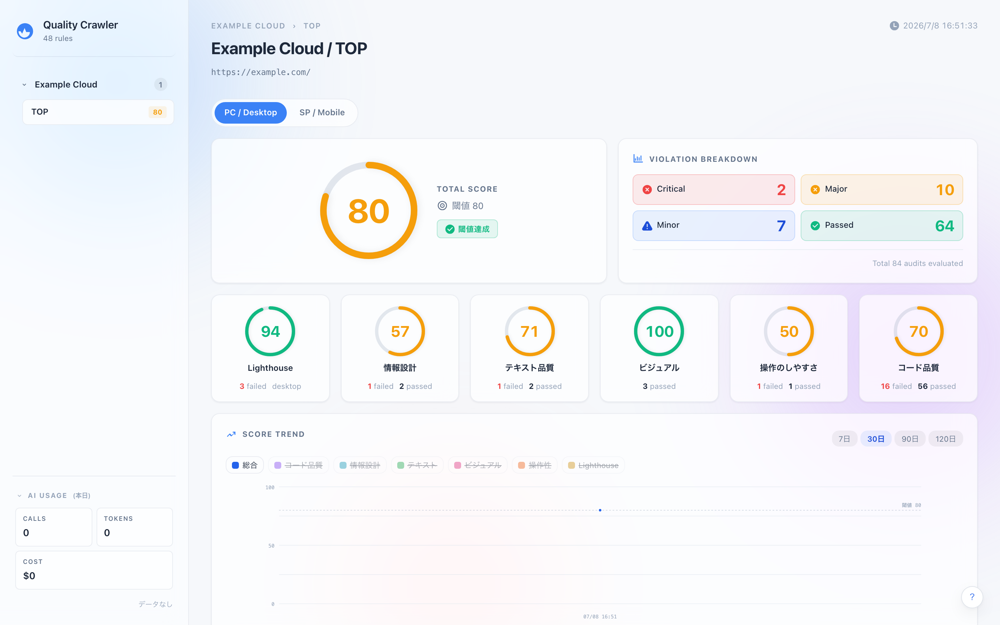
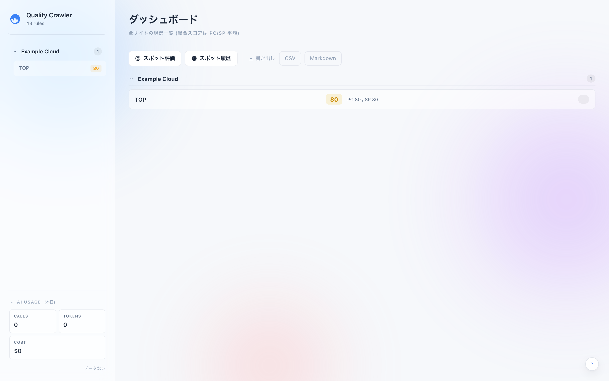

# web-quality-crawler

Web サイトの品質を **コード品質 / 情報設計 / テキスト品質 / ビジュアル / 操作のしやすさ** + Lighthouse 4 カテゴリの計 9 観点から自動評価する、クローラー + ダッシュボードです。

**決定的ルール 48 件 + AI ルール 25 件 = 計 73 件** をカテゴリ別に重み付けしてスコアリングし、検知箇所には全画面スクリーンショット上の bbox ハイライトと、Claude による AI 修正提案 / 改善優先度レコメンドを付与します。

> 個人開発のポートフォリオ用プロジェクトです。Playwright / Lighthouse / Claude API / SQLite / Express を組み合わせ、「壊れずに回り続ける」ための設計判断（プロセス分離・直列実行・キャッシュ戦略）に重点を置いています。

## スクリーンショット

ページ詳細 — 総合スコア / 違反内訳 (Critical・Major・Minor・Passed) / カテゴリ別スコア / スコア推移:



全サイトの現況一覧 (総合スコアは PC/SP 平均):



---

## 解決する課題

サイト品質の点検は「Lighthouse を見る」「目視でレビューする」に分断されがちで、

- 機械的に測れる指標（アクセシビリティ / パフォーマンス / 構造化データ）と、
- 人が読まないと分からない品質（情報設計 / 文章 / ブランド遵守）

が別々のツール・別々のタイミングで扱われます。本プロジェクトは両者を **1 回のクロールで同一レポートに統合**し、決定的ルールと LLM 評価を同じスコアリング体系に載せて可視化します。検知箇所はスクリーンショット上に矩形でハイライトされ、そのまま修正提案まで辿れます。

## 技術的ハイライト（設計判断）

「動く」だけでなく「本番で落ちない」ことを重視して、以下を意図的に選択しています。

- **クロールはターゲット単位で使い捨て子プロセスに分離** — Node + Playwright Chromium + Lighthouse 経由の chrome-launcher Chromium の 3 プロセスが合算でメモリを食い、コンテナ cgroup OOM を起こした経験から、1 ターゲットごとに `child_process.fork` して使い捨てる方式に。1 ページの事故で全クロールを失わず、累積メモリリークも断ち切る（`lib/crawl-runner.js`）。
- **直列実行を前提に倒す** — 並列化を試みたが Lighthouse の `performance.mark` 衝突とメモリ圧迫で断念。`CRAWL_CONCURRENCY=1` を既定にし、サーバ側キューで順番待ちさせる。速度より安定性を取った判断。
- **Lighthouse は同一プロセス内 mutex** — chrome-launcher が Playwright の Chromium executablePath を再利用し、二重起動を防ぐ。
- **重い AI 呼び出しも子プロセスに隔離** — `/api/prioritize` は Anthropic SDK のレスポンスバッファ + `JSON.parse` で V8 ヒープを膨らませて親ごと落ちた経緯があり、使い捨て worker に分離。親の Express は 500 を返して生存を続ける。
- **AI コストを 2 段でキャッシュ** — 共通評価フレームワークに Anthropic Prompt Caching（`cache_control: ephemeral`）を適用しつつ、評価結果・修正提案はディスクにも sha256 キーでキャッシュ。ヒット時は API を呼ばずコスト 0。
- **決定的 47 + AI 25 の二層評価** — 再現性が要る項目はコードで、判断が要る項目は LLM で。両者を同じ重み付けスコアに合流させる。
- **設定・レポートの正本は SQLite** — 画像はファイル、構造化データは DB。ダッシュボードからの編集も DB に書く。
- **ゲート条件で早期スキップ** — `body` 開始位置が 28KB を超えるページは以降の評価をスキップし、無駄な処理と誤検知を避ける。

## 技術スタック

Node.js 20 / Playwright / Cheerio / Lighthouse / chrome-launcher / Express / better-sqlite3 / esbuild / Anthropic Claude API

---

## カテゴリ構成と既定重み

総合スコアは **メインカテゴリ 5 種 + Lighthouse 4 種** の加重平均で算出されます（合計 1.00）。

| 区分 | カテゴリ | 既定重み | 備考 |
|---|---|---|---|
| メイン | code (コード品質) | 10% | サブ: llmo / semantic / structured / readable / a11y / perf / links |
| メイン | info (情報設計) | 15% | 重要セクションのラベリング / 並列要素の整列 / ターゲット明示 等 |
| メイン | text (テキスト品質) | 10% | 一文長 / NG ワード / 表記揺れ / 見出し本文整合 等 |
| メイン | visual (ビジュアル) | 10% | 画像品質 / コントラスト / UI パターン / ロゴ / ブランド遵守 |
| メイン | usability (操作のしやすさ) | 10% | CTA 明確性 / エラーメッセージ / 状態フィードバック 等 |
| LH | lh-performance | 5% | Lighthouse Performance |
| LH | lh-accessibility | 20% | Lighthouse Accessibility (重め) |
| LH | lh-best-practices | 10% | Lighthouse Best Practices |
| LH | lh-seo | 10% | Lighthouse SEO |

各サブカテゴリスコアは「ルールの重み付きパス率」、メインカテゴリスコアはサブの単純平均。重みは domain 単位に上書き可能です。

ゲート: `gate/body-start-offset`（body 開始位置が 28KB 以内、未通過なら全評価スキップ）

## ルール内訳 (計 73)

### 決定的ルール (48)
- **llmo (5)**: llms.txt 存在 / 最低限の内容 / robots.txt / canonical / OGP
- **semantic (7)**: landmarks / main / h1 / heading / th-scope / div 比率 / section-article-with-heading
- **structured (4)**: JSON-LD 存在 / 構文 / @context・@type / BreadcrumbList
- **readable (5)**: テキスト量 / CSS 擬似要素 / table-dl / alt 実効性 / lang 属性
- **a11y (6)**: img-alt / form-labels / button 名 / button-vs-anchor / ARIA 状態 / リンクテキスト
- **perf (6)**: head 内インライン / HTML サイズ / LCP / CLS / TBT / TTFB
- **links (3)**: 4xx-5xx / 到達不能 / リダイレクトチェーン
- **info (3)**: specific-section-labels / heading-visual-hierarchy / required-service-items
- **text (3)**: sentence-length / ng-words / notation-consistency
- **visual (4)**: image-quality / contrast / ui-pattern-consistency / ds-margin
- **usability (2)**: cta-label-specificity / cta-placement

### AI ルール (25)
- **意味論的判定 (6)**: heading-semantics / meta-description-quality / alt-text-quality / jsonld-page-alignment / link-text-semantics / llms-txt-content-quality
- **info-architecture (7)**: 重複検知 / セクション単一テーマ / ブロック単一目的 / 並列要素整形 / 役割分離 / ターゲット明示 / 差別化根拠
- **text-quality (4)**: 画像優先 vs テキスト優先 / 指示語明確性 / 見出し本文整合 / サービス名表記
- **visual-usability (6)**: 強調と優先順位の一致 / CTA 配置 / エラーメッセージ具体性 / 状態フィードバック / フロー再開明確性 / 入力状態可視性
- **ガイドライン参照型 (2)**: logo-regulation / brand-guideline (`config/brands/<id>/` から動的にガイドライン本文を読み込み system prompt に展開)

---

## 必要要件

- Node.js 20 以上
- Playwright が Chromium をダウンロードできるネットワーク
- (AI 機能を使う場合) Anthropic API キー

## セットアップ

```bash
npm ci
npx playwright install --with-deps chromium
cp .env.example .env    # ANTHROPIC_API_KEY 等を設定
```

## 実行

### ダッシュボードサーバ (Express / port 3001)

```bash
npm run start:local   # .env 読み込み + node scripts/server.js
# ブラウザで http://127.0.0.1:3001/
```

`prestart` スクリプトで `scripts/build-frontend.js` が走り、`public/js/dashboard.js` を esbuild でミニファイします。

### クローラー (単発実行)

```bash
npm run crawl:local                                         # 既定設定で実行
CONFIG_PATH=config/targets.example.json npm run crawl:local # サンプル設定で実行
```

クローラー結果は `public/reports/<timestamp>/` に出力されます。ダッシュボードからは UI 操作で個別ページをクロールすることも可能です。

初回起動時、DB が空なら `config/targets.example.json` を取り込んで初期データとします（`example.com` を対象にしたサンプル 1 件）。評価したいサイトは UI もしくは JSON で追加してください。

## 出力

```
public/reports/<timestamp>/
├── report.json                               全結果 (配列 results[])
└── assets/<domainId>/<pageId>/screenshot.png 全画面スクリーンショット
```

`report.json` の構造例:
```json
{
  "startedAt": "2026-01-01T10:00:00.000Z",
  "results": [
    {
      "site": { "domainId": "...", "pageId": "top", "url": "...", "weights": {}, "thresholds": {} },
      "pageData": { "url": "...", "webVitals": {}, "screenshot": "/reports/.../screenshot.png", "dimensions": {} },
      "lighthouse": { "performance": 92, "accessibility": 88, "best-practices": 100, "seo": 95 },
      "violations": [
        {
          "id": "semantic/landmarks",
          "category": "semantic",
          "mainCategory": "code",
          "severity": "major",
          "passed": false,
          "message": "...",
          "offenders": [ { "selector": "...", "rect": { "x": 0, "y": 0, "w": 200, "h": 50 } } ]
        }
      ],
      "score": { "total": 68, "categories": {}, "mainCategories": {}, "counts": {} }
    }
  ]
}
```

## API エンドポイント

### データ参照
| Path | 内容 |
|---|---|
| `GET /api/config` | `domains → pages` 階層の設定 |
| `GET /api/runs` | 全 run のサマリ一覧 (新しい順) |
| `GET /api/latest` | 最新 run のサマリ |
| `GET /api/rules` | ルール定義一覧 (ヘルプモーダル用) |
| `GET /reports/<timestamp>/report.json` | 個別レポート全文 |

### 構成管理
| Path | 内容 |
|---|---|
| `POST /api/domains` | ドメイン追加 (`pages` があれば初回クロール自動発火) |
| `PATCH /api/domains/:domainId` | ドメイン部分更新 (クロール休止/再開) |
| `DELETE /api/domains/:domainId` | ドメイン削除 |
| `POST /api/domains/:domainId/pages` | ページ追加 (初回クロール自動発火) |
| `PATCH /api/domains/:domainId/pages/:pageId` | ページ部分更新 (名前 / URL / 担当者 / 休止) |
| `DELETE /api/domains/:domainId/pages/:pageId` | ページ削除 |

### クロール
| Path | 内容 |
|---|---|
| `POST /api/crawl/:domainId/:pageId` | 手動クロール起動 |
| `POST /api/crawl/spot` | スポット評価 (URL 1 回限り、構成保存しない) |
| `GET /api/crawl/status?id=<jobId>` | 非同期クロールジョブの状態 |

### AI 機能
| Path | 内容 |
|---|---|
| `GET /api/ai/status` | AI 有効化の判定 |
| `GET /api/usage` | トークン利用量 (本日 / 今月 / 累計) |
| `POST /api/suggest` | 個別 audit に対する修正提案 (Markdown) |
| `POST /api/prioritize` | 改善優先度 Top 3〜5 — **使い捨て子プロセスで実行** |

### 横断ビュー / エクスポート
| Path | 内容 |
|---|---|
| `GET /api/cross-view?ruleId=<id>` | 最新 run で該当ルールが失敗している全ページ |
| `GET /api/export/latest.csv` | 最新 run の全結果 CSV (Excel 互換 BOM 付き) |
| `GET /api/export/latest.md` | 最新 run の全結果 Markdown |

管理者限定操作（ドメイン/ページの追加・削除・再クロール等）は簡易認証で保護されます。資格情報は `ADMIN_ID` / `ADMIN_PASS`（既定 `admin` / `change-me`）で、**公開運用時は必ず変更**してください。

## 環境変数

| 変数 | 用途 | 既定 |
|---|---|---|
| `ANTHROPIC_API_KEY` | AI 機能の API キー (未設定で AI 機能は無効) | — |
| `AI_EVALUATION_ENABLED` | `true` で AI ルールを評価対象に含める | `false` |
| `AI_MODEL` | AI モデル名 | `claude-sonnet-4-6` |
| `AI_MAX_TOKENS` | AI 応答の最大トークン | `4096` |
| `AI_PREFETCH` | クロール後の修正提案事前生成範囲: `all` / `critical` / `none` | `all` |
| `RULE_AI_CONCURRENCY` | AI ルールの同時実行数 (V8 ヒープ圧迫対策で絞ってある) | `3` |
| `CRAWL_CONCURRENCY` | クロールの同時実行数 (Lighthouse mutex のため実質 1 推奨) | `1` |
| `LIGHTHOUSE_ENABLED` | `false` で Lighthouse を停止 (緊急時) | `true` |
| `PRIORITIZE_WORKER_HEAP_MB` | prioritize 子プロセスの V8 ヒープ上限 | `768` |
| `PRIORITIZE_WORKER_TIMEOUT_MS` | prioritize 子プロセスのタイムアウト | `90000` |
| `NODE_OPTIONS` | V8 ヒープ上限を明示 (推奨: `--max-old-space-size=1536`) | — |
| `ADMIN_ID` / `ADMIN_PASS` | ダッシュボード管理者モードの資格情報 | `admin` / `change-me` |
| `LOG_LEVEL` | `debug` / `info` / `warn` / `error` | `info` |
| `CONFIG_PATH` | シード元 JSON のパス | `config/targets.json` |
| `REPORTS_DIR` | レポート出力先 | `public/reports/` |
| `DB_PATH` | SQLite DB のパス | `data/app.db` |
| `PORT` / `HOST` | ダッシュボードサーバの listen 設定 | `3001` / `127.0.0.1` |

## ディレクトリ構成

```
.
├── config/
│   ├── targets.example.json          初期シード用サンプル設定 (git 管理)
│   ├── targets.json                  実運用設定 (gitignore — UI 編集対象)
│   └── brands/<id>/                  ブランド参照型 AI ルール用ガイドライン
├── scripts/
│   ├── run.js                        クローラー (単発実行 / cron エントリ)
│   ├── server.js                     ダッシュボードサーバ (Express, :3001)
│   ├── crawl-worker.js               クロールの使い捨て子プロセス本体
│   ├── build-frontend.js             esbuild で public/js/dashboard.js を生成
│   └── prioritize-worker.js          /api/prioritize の使い捨て子プロセス本体
├── lib/
│   ├── crawl.js                      crawl + 報告 + bbox 解決 + スクショ保存
│   ├── crawl-runner.js               crawl-worker を fork する共通ランナー
│   ├── runner.js                     ルール実行エンジン
│   ├── fetcher.js                    Playwright + CWV + リンク検査ヘルパ
│   ├── lighthouse.js                 Lighthouse mutex + chrome-launcher ラッパ
│   ├── scorer.js                     重み付きスコア計算 (5 main + LH 4)
│   ├── gate.js                       ゲート条件判定
│   ├── db.js / config.js / report-store.js   SQLite 永続化まわり
│   └── ai/
│       ├── evaluate.js               AI ルール共通呼び出し (SHARED_FRAMEWORK + Prompt Caching)
│       ├── suggest.js                個別 audit の修正提案
│       ├── prioritize.js             改善優先度レコメンド (worker 経由)
│       ├── cache.js                  ディスクキャッシュ (sha256 キー)
│       └── cost-tracker.js           トークン/コスト集計 + 日別永続化
├── rules/                            全 73 ルール (llmo/semantic/.../ai/)
├── public/                           静的ファイル (SPA シェル + dashboard.js/.css)
└── data/                             SQLite DB (gitignore)
```

## ルールインターフェース

```js
export default {
  id: 'category/rule-name',
  name: 'ルール名 (日本語)',
  category: 'llmo' | 'semantic' | 'structured' | 'readable' | 'a11y' | 'perf' | 'links'
          | 'info' | 'text' | 'visual' | 'usability',
  severity: 'critical' | 'major' | 'minor',
  weight: 2 | 3 | 4 | 5,           // カテゴリ内の相対重み
  fix: '修正ガイダンス (日本語)',
  check: (pageData, options = {}) => {
    // pageData: { $, html, url, title, webVitals, linkCheck, _playwright, ... }
    // return: { passed: boolean, message?, offenders?, offendersTotal?, offendersTruncated? }
  },
};
```

AI ルールは `rules/ai/` 配下に配置し、`aiRule: true` フラグを持ち `lib/ai/evaluate.js` を経由して JSON Schema に沿った構造化出力を得ます。

## ブランド (商材) 設定

ブランド固有のルール (`ai/logo-regulation` / `ai/brand-guideline`) は `config/brands/<id>/` 配下のガイドライン文書を動的に読み込んで評価します。**新ブランド追加 = ディレクトリを置くだけ**（ルールコードは触らない）。

```
config/brands/
└── example/                  ← 同梱のサンプルブランド
    ├── meta.json             ブランド名 / 表記ルール / 推奨用語等
    ├── logo-guideline.md     ロゴ規定 (ai/logo-regulation 用)
    └── visual-guideline.md   色 / フォント / 見出しサイズ規定 (ai/brand-guideline 用)
```

domain に `"brand": "example"` を指定すると、そのドメインのページにブランド固有ルールが適用されます。`brand` 未指定の domain ではこれらの AI ルールはスキップ扱い (passed=true) になります。

新ブランド追加手順:
1. `config/brands/<brand-id>/` を作成
2. `meta.json` に最低限 `id` と `name` を記載
3. `logo-guideline.md` / `visual-guideline.md` をプレーンマークダウンで配置
4. 対象 domain の `brand` フィールドにブランド ID を指定

## 終了コード (scripts/run.js)

| コード | 意味 |
|---|---|
| 0 | すべてパス |
| 1 | Critical 違反あり |
| 2 | ゲート未通過 |
| 3 | 実行時エラー |

## デプロイ

Express が静的配信 + API + SPA を 1 プロセスで賄うため、コンテナは Node 単体で完結します（TLS は前段のリバースプロキシ / PaaS に任せる）。同梱の [`Dockerfile`](Dockerfile) はどのホストでも同じイメージで動きます。

### 自前サーバ / VPS (docker compose)

```bash
cp .env.example .env        # ANTHROPIC_API_KEY / ADMIN_ID / ADMIN_PASS 等を設定
docker compose up -d --build
# 前段のリバースプロキシ (Caddy / nginx / Traefik) で :3001 を TLS 終端して公開する
```

- **メモリ**: Playwright Chromium + Lighthouse 経由の Chromium が並走するため **2GB 以上（推奨 3GB）** を割り当てる。不足すると cgroup OOM でクロールが落ちる。
- **永続化**: `data/`（SQLite 正本）と `public/reports/`（スクショ）を volume で永続化する。怠るとデプロイ毎にデータが消える。
- **定期クロール**（任意）: ホストの cron 等で `docker compose exec web-quality-crawler npm run crawl`。

### PaaS (Render / Fly.io / Railway 等)

- Docker デプロイに対応した PaaS にそのまま載せられる。listen ポートはプラットフォームが注入する `PORT` を `server.js` が参照する。
- **2GB 以上のインスタンス**を選ぶこと（無料枠の 512MB 級では Chromium/Lighthouse が OOM する）。
- **永続ディスク**を `DB_PATH`（既定 `/app/data`）にマウントし、SQLite を揮発させない。
- 環境変数: `ANTHROPIC_API_KEY`（AI 機能を使う場合）/ `ADMIN_ID` / `ADMIN_PASS`（**必ず変更**）。

開発時の設計メモ・落とし穴は [CLAUDE.md](CLAUDE.md) を参照。

## ライセンス

[MIT](LICENSE)
